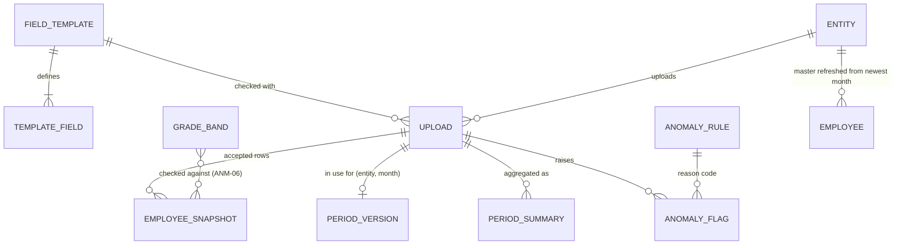

# Schema `groupdata` (slices S8–S9)

Migrations: `packages/db/migrations/core/0013_group_data`, `0014_data_quality` (up/down), recorded in `migrations.core`. Decision: ADR-015. Design: `docs/design/r2-group-dashboard.md`. Repositories: `packages/db/src/group-data.ts`, `data-quality.ts`, `approved-increments.ts`.

Sensitivity: **Config** (no personal data), **Personal** (names, dates, employee IDs), **Pay** (salary values, encrypted), **Derived** (aggregates, no individual pay).

## ERD

## Data dictionary

### `groupdata.field_template` — versioned field template (R2-02), Config

| Column                 | Type        | Null | Meaning                                                          |
| ---------------------- | ----------- | ---- | ---------------------------------------------------------------- |
| id                     | uuid        | no   | Template version ID (v1: `00000000-0000-4000-8000-0000000f7e01`) |
| version                | integer     | no   | 1, 2, … unique                                                   |
| status                 | text        | no   | `active` (exactly one, partial unique index) or `retired`        |
| activated_at           | timestamptz | yes  | When it became active                                            |
| created/updated_at/_by |             | no   | Who published it                                                 |

### `groupdata.template_field` — the columns of a template version, Config

| Column         | Type     | Null | Meaning                                                                           |
| -------------- | -------- | ---- | --------------------------------------------------------------------------------- |
| template_id    | uuid     | no   | → field_template                                                                  |
| position       | smallint | no   | Column order 1–60 (unique per template)                                           |
| key            | text     | no   | `^[a-z][a-z0-9_]{1,39}$`, unique per template                                     |
| label          | jsonb    | no   | `{en, ar?}`: the column heading in the file and on screen                         |
| type           | text     | no   | `text`, `date`, `decimal`, `enum`                                                 |
| required       | boolean  | no   | A blank value is an error (dashboard fields always required, enforced by the API) |
| core           | boolean  | no   | One of the 15 fixed fields (key and type locked)                                  |
| allowed_values | text[]   | no   | For `enum`                                                                        |
| palm_hr_field  | text     | yes  | Mapped Palm HR field (R2-14, placeholder until A7)                                |

Placeholder v1: employee ID, full name, department, designation, grade, gross and basic monthly salary, currency, date of joining, date of birth, gender (female/male), nationality, employment status (active/on_leave/left), leaving date, cost centre.

### `groupdata.grade_band` — salary band per grade (ANM-06, D5/D6), Config

`grade` (PK), `position`, `min_salary`, `max_salary` (`numeric(12,2)`, aggregates-only config, not individual pay), `currency`, `updated_at/_by`. Seeded G1–G7 in AED from Figma (placeholders).

### `groupdata.upload` — every file uploaded (R2-01, R2-08), Personal (file name, uploader)

| Column                                      | Type    | Null | Meaning                                                                       |
| ------------------------------------------- | ------- | ---- | ----------------------------------------------------------------------------- |
| id                                          | uuid    | no   | Upload ID (also the object key suffix)                                        |
| reference                                   | text    | no   | `UP-NNNN` (sequence `upload_number_seq`)                                      |
| entity_id                                   | uuid    | no   | Subsidiary (RLS)                                                              |
| period                                      | date    | no   | First day of the month                                                        |
| version                                     | integer | yes  | 1, 2, … per (entity, period); null when rejected (CHECK)                      |
| status                                      | text    | no   | `rejected` (needs errors > 0), `accepted`, `superseded`                       |
| template_id                                 | uuid    | no   | Template version it was checked with                                          |
| file_name                                   | text    | no   | Sanitised original name (≤ 150)                                               |
| object_key                                  | text    | no   | `group-uploads/{entity}/{id}` in private storage (ADR-010)                    |
| media_type, size_bytes, sha256, scan_engine |         | no   | What was stored and scanned; `sha256` refuses re-uploading the version in use |
| rows, errors, warnings                      | integer | no   | Data rows read; problem counts                                                |
| issues                                      | jsonb   | no   | `[{row, field, code, severity}]`, ≤ 2,000, **never cell values**              |
| comparison                                  | jsonb   | yes  | Against the previous month (R2-09): counts and percentages only               |
| flags                                       | integer | no   | Flags raised                                                                  |
| uploaded_by, uploaded_by_name, uploaded_at  |         | no   | Who and when (R2-08)                                                          |

Grants: app role `SELECT, INSERT`, `UPDATE (status, flags)` only.

### `groupdata.employee_snapshot` — one row per employee per accepted upload (R2-04), Personal + Pay

Partitioned by `period` (yearly 2024–2028 + default). Append-only (trigger `audit.refuse_change`). PK `(period, id)`; unique `(period, upload_id, employee_number)`.

| Column                                                                          | Sensitivity | Meaning                                                 |
| ------------------------------------------------------------------------------- | ----------- | ------------------------------------------------------- |
| upload_id, entity_id, period, row_number                                        | —           | Where it came from (row in the file)                    |
| employee_number, full_name, department, designation, grade                      | Personal    | Core fields                                             |
| gross_salary, basic_salary                                                      | **Pay**     | `bytea`, AES-GCM, AAD = table, column, row ID (ADR-008) |
| currency                                                                        | —           | ISO 4217                                                |
| date_joined, date_of_birth, gender, nationality, status, date_left, cost_centre | Personal    | Core fields                                             |
| extra                                                                           | Personal    | Admin-added fields, as text                             |

### `groupdata.period_version` — the version in use (R2-04)

PK `(entity_id, period)` → `upload_id`, `version`, `accepted_at`. Moves to each new accepted version.

### `groupdata.period_summary` — dashboard aggregates (R2-05, NFR-PERF-01), Derived

PK `(entity_id, period, department)`, `upload_id`, `metrics` jsonb: `headcount`, `joiners`, `leavers`, `female`, `male`, `otherGender`, `ageBands{under_25,25_34,35_44,45_54,55_plus,unknown}`, `grades{grade:{headcount, payroll{currency:amount}}}`, `payroll{currency:amount}`. Replaced with each accepted version; always recomputable from snapshots. Department totals only — never one person's pay (a department of one is still a total; D8 shows group totals only).

### `groupdata.anomaly_rule` — the rules (R2-10), Config

`code` (`ANM-NN`), `kind` (one per rule), `threshold numeric(6,2) > 0` (percent; months for ANM-04; percent tolerance for ANM-05; null = any change / no threshold), `enabled`, `updated_at/_by/_by_name`. Seed: ANM-01 missing employee, 02 grade change, 03 salary change > 20 %, 04 salary changed after 12 stable months, 05 off the approved increment by > 1 %, 06 outside grade band, 07 employee ID in another subsidiary, 08 headcount > 10 %, 09 payroll > 10 %. App role: `SELECT`, `UPDATE (threshold, enabled, updated_*)`; group scope only (RLS).

### `groupdata.anomaly_flag` — a flag and its resolution (R2-10, R2-11), Personal + Pay

| Column                                | Meaning                                                                   |
| ------------------------------------- | ------------------------------------------------------------------------- |
| reference                             | `AN-NNNN` (sequence `flag_number_seq`)                                    |
| entity_id, period, upload_id          | Where it was raised (RLS on entity)                                       |
| rule_code                             | → anomaly_rule                                                            |
| employee_number, employee_name, field | The record (null for subsidiary-level ANM-08/09)                          |
| detail                                | **Pay**: encrypted JSON of display values (previous, current, expected …) |
| owner_id, owner_name                  | Who resolves it (the uploader by default)                                 |
| status                                | `open`, `in_progress`, `resolved` (CHECK: resolved ⇔ `resolved_at`)       |
| resolution_note                       | **Encrypted** note (required to resolve, enforced by the API)             |
| resolved_reason                       | `superseded` when a newer version closed it                               |

## Functions

- `groupdata.employee_numbers_elsewhere(entity, period, numbers[]) → text[]` — `SECURITY DEFINER`; returns which of the given IDs are in use in **another** subsidiary that month (ANM-07), switching to group scope for this one query and restoring the caller's scope. `EXECUTE` for the app role only.
- `notify.queue_group_reminders() → integer` — `SECURITY DEFINER`, no arguments, `EXECUTE` for the worker role only: `upload_due` (last month not uploaded `days` after it ended, to every HR user assigned to the subsidiary) and `flag_open` (open longer than `days`, to the owner), once each via `notify.reminder_log`.

## Row-Level Security

| Table                                                                   | Policy                                                                  |
| ----------------------------------------------------------------------- | ----------------------------------------------------------------------- |
| upload, employee_snapshot, period_version, period_summary, anomaly_flag | `core.can_access_entity(entity_id)` for read and write (FORCE)          |
| field_template, template_field, grade_band, anomaly_rule                | Read: everyone; insert/update: `core.current_scope() = 'group'` (FORCE) |

Tests: `packages/db/src/group-data.test.ts` and `data-quality.test.ts` (cross-subsidiary reads, uploads, files, extracts and flags refused; subsidiary can't publish the template or change rules; worker can't read flags).

## Indexes

| Index                                                                | Serves                                        |
| -------------------------------------------------------------------- | --------------------------------------------- |
| upload_entity_period_idx (entity, period, uploaded_at desc)          | Upload history per subsidiary and month       |
| upload_period_idx (period, uploaded_at desc)                         | Upload history per month (Sirius HR)          |
| employee_snapshot_upload_idx (upload_id)                             | Records of a version (employee data, extract) |
| employee_snapshot_employee_idx (entity, employee_number, period)     | Record history, salary history (ANM-04)       |
| period_version_period_idx, period_summary_period_idx                 | Month filters on dashboards                   |
| anomaly_flag_entity_period_idx, _period_idx, _upload_idx, _owner_idx | D7 filters, supersede, `flag_open` reminders  |

## Retention (proposal, confirm with Sirius under NFR-PRIV-01)

Snapshots and uploads: 7 years (payroll records), then drop the year's partition and the stored files. Rejected uploads: 1 year. Flags: as their upload. Aggregates: as long as the group reports need them (no individual pay).
